# DESIGN.md: Hotel8:Upsell — Detailed Design Document

## 1. Scope & Context

**Owned by Upsell:** database `hotel8`, schema `upsell` — 5 tables
(`upsell.eligibility_rules`, `upsell.offers`, `upsell.upsell_transactions`,
+ producer tables `upsell.outbox` / `upsell.audit_journal`); event family
`upsell`; the offer-generation direct consumer; RFW admin pages.

**NOT owned:** guest identity/tier truth (Sentin8:Auth + PMS profile),
room inventory (hotel8:pms), money movement (Bill8:Payments via the
payments lane), notification transport (Sentin8:Post), scheduling
(Sentin8:Cron).

### System context

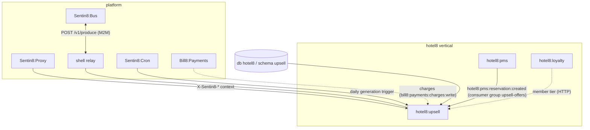

### Container view

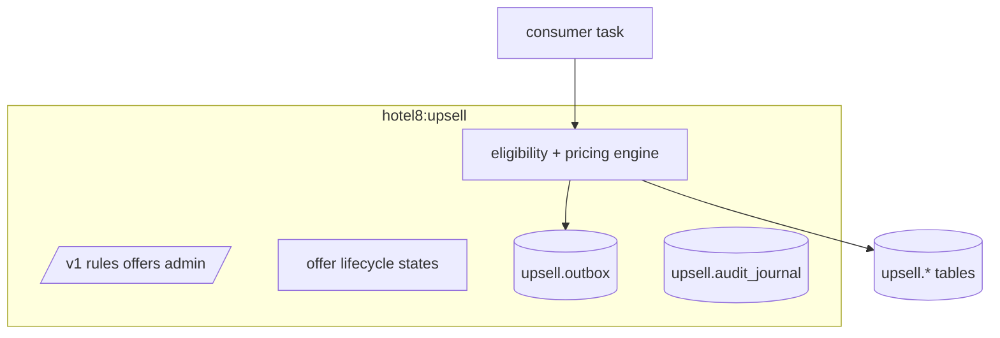

## 2. Runtime Architecture

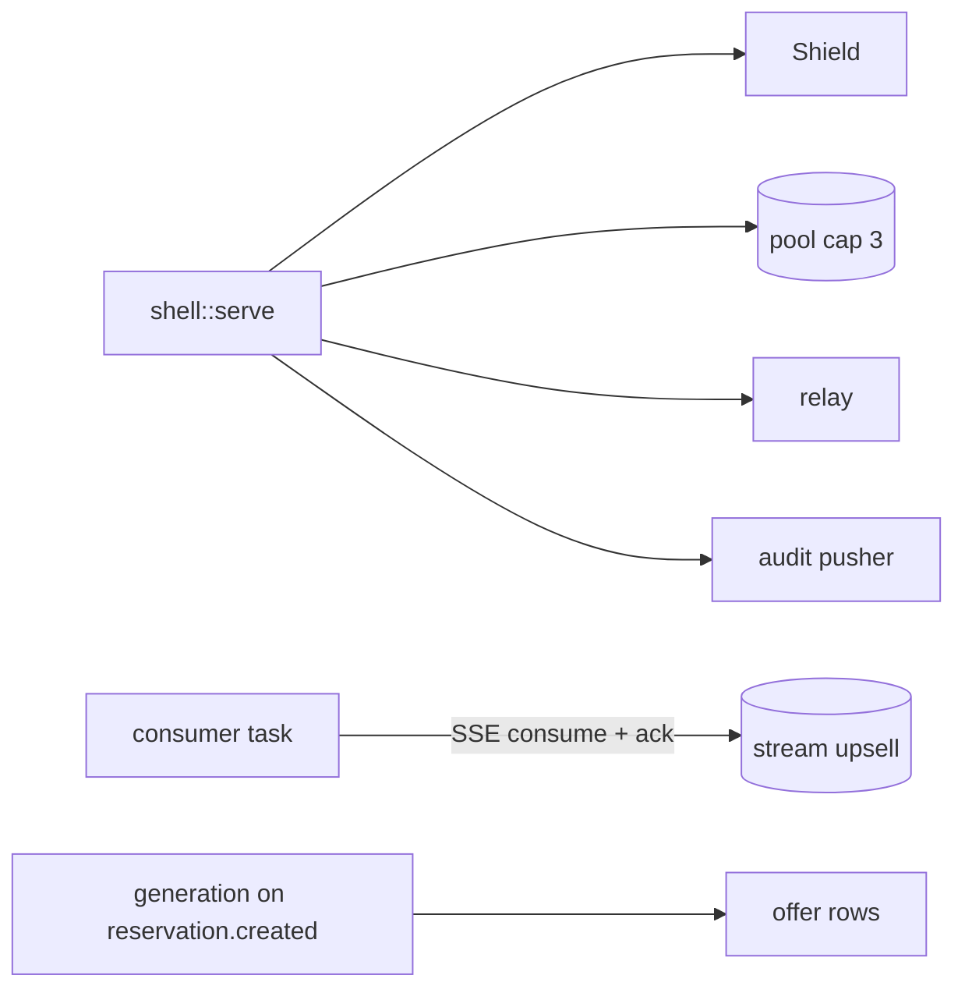

### Request lifecycle — offer generation (event path)

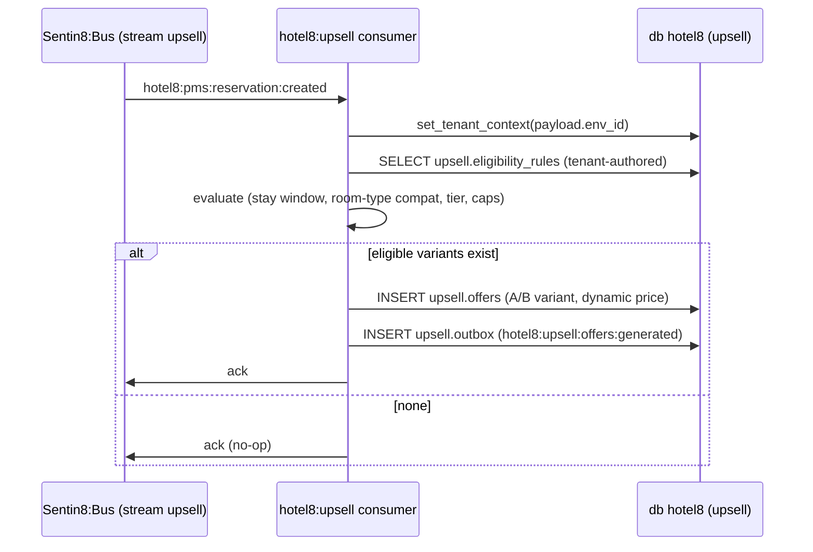

### Request lifecycle — guest accepts (API path)

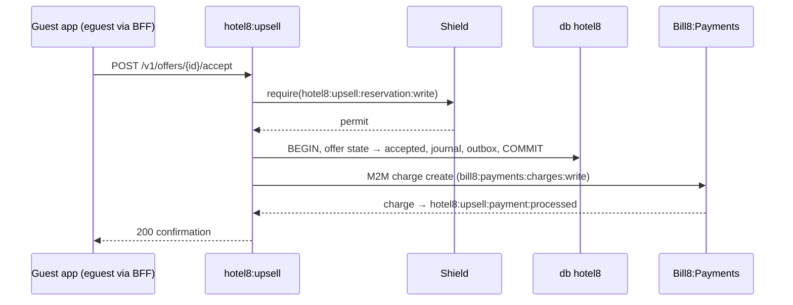

## 3. Data Model

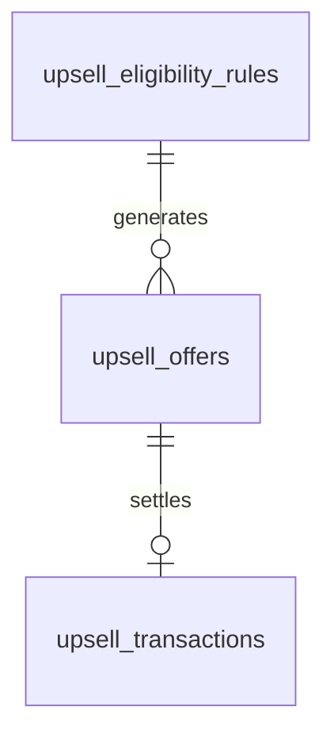

- `upsell.eligibility_rules` — tenant-authored rule sets (env-scoped).
- `upsell.offers` — generated offers: booking ref, variant, dynamic price
  + provenance, lifecycle state, decline memory.
- `upsell.upsell_transactions` — acceptance/settlement records.

### Offer state machine

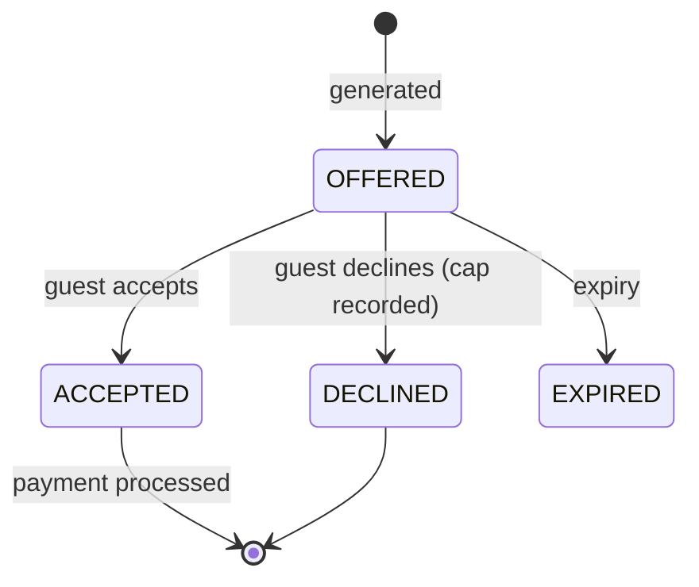

## 4. API Surface

**Public** (guest-facing through BFF; `hotel8:upsell:{read,admin}` mirror):
list my offers, accept/decline offer, offer detail.

**Admin** (`hotel8:upsell:admin` + Shield admin triplet): eligibility rules
CRUD (`hotel8:upsell:rule:created`, `rule:test` preview), A/B test setup,
transaction browsing, offer configuration
(`hotel8:upsell:offer:configured`).

### Cross-service data access — decision order (membus → bus → owner API)

Offer generation is event-first: `hotel8:pms:reservation:created` (consumer
group `upsell-offers`) carries the booking snapshot in the payload — the hot
path needs **zero** PMS call-backs (payload completeness rule). MemBus:
none (no tick-level state to refresh; offers change at human pace).
Residual synchronous reads (stay-context enrichment for the guest offer
list: reservation, inventory, profile) use the PMS owner API with an upsell
M2M token — a read of public query surfaces, never a bespoke internal
endpoint. No pms-schema grant exists or is allowed.

**Event flow** — identical outbox → relay → `upsell` stream shape:

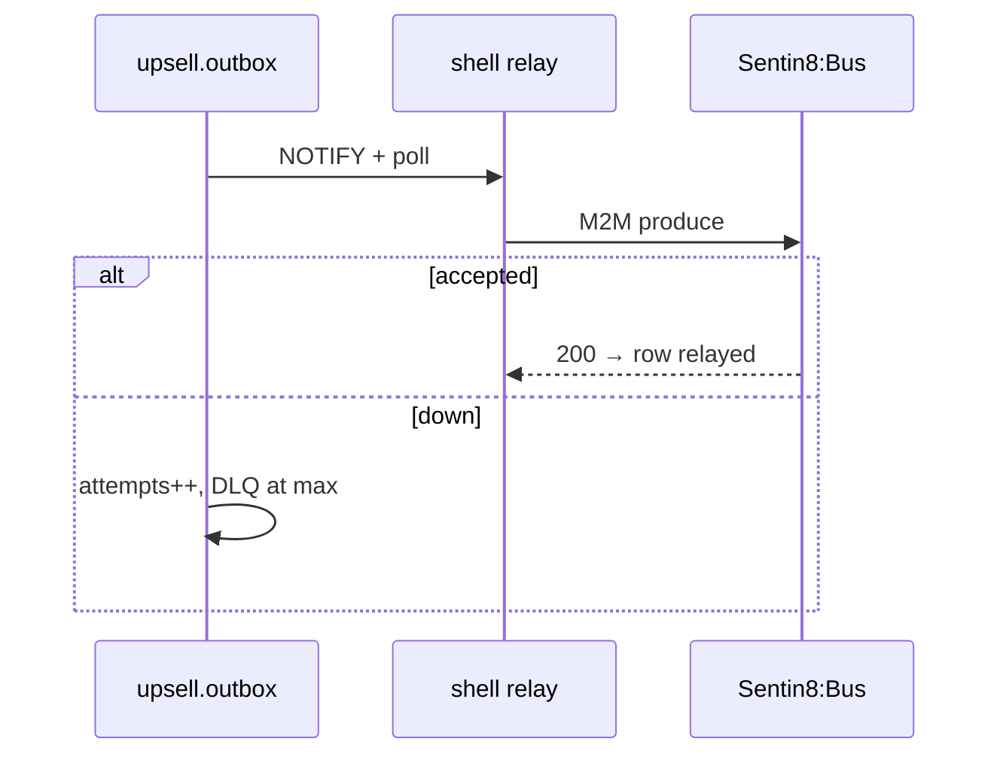

## 5. Cross-Cutting Concerns

- Auth/tenant/RLS/audit/drain/TLS/pool — the platform contract, identical to
  PMS/POS construction; event-driven generation is the consumer-first path
  (no internal API exists for "generate on booking").
- Frequency caps and decline memory are enforcement, not presentation — the
  engine filters before pricing.

## 6. Failure Modes & Recovery

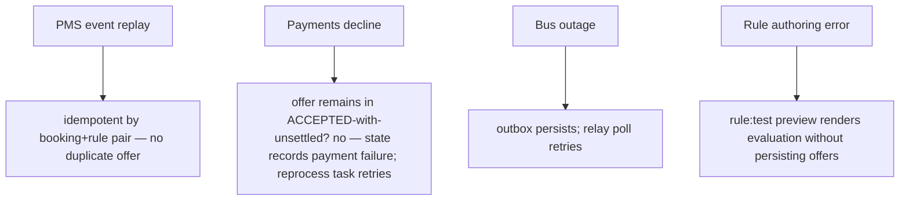

## 7. Concurrency & Performance Model

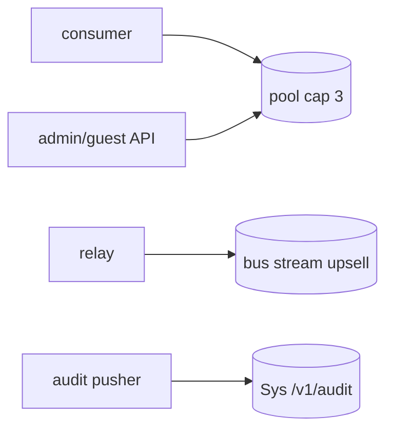

- Single runtime; the consumer task handles the PMS stream; pool cap 3.
- Generation cost is dominated by rule evaluation (in-memory) + one INSERT;
  the event payload carries the booking snapshot — no PMS call-back on the
  hot path.

## 8. Invariants, Insecure-Defaults Rejected, Unsafe Rationale

- One live offer per (booking, rule, variant-slot); declines are remembered
  per stay — a guest never sees the same declined offer class again.
- Payment state is only ever a *reflection* of payments results (never
  self-asserted).
- No `unsafe`; no platform-DB access; secrets never stored.
- Insecure defaults rejected: no offers generated for guests marked
  non-contactable (consent respected at the engine level).

## 9. Testing Strategy

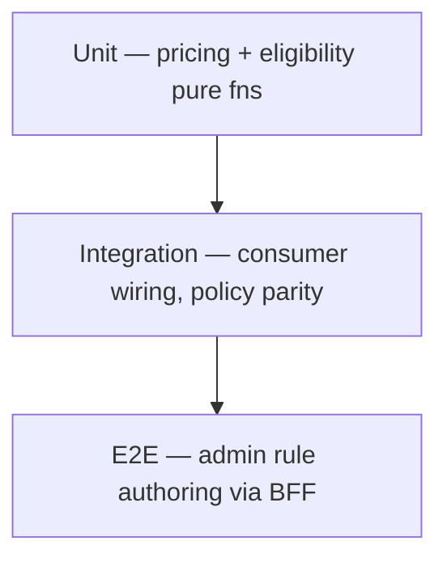

- Unit: rule evaluation truth tables; price provenance; variant allocation.
- Integration: consumer idempotency under replay; policy mirror coverage.
- NOT here: Shield internals, Cron scheduling.

## 10. Open Questions

- Multi-armed allocation beyond A/B.
- Multi-touch stay-long journeys.

---

**Design attribution:** hotel8:upsell and its underlying concepts were designed by Hamid Jahanzad <Hamid@Jahanzad.com>.
