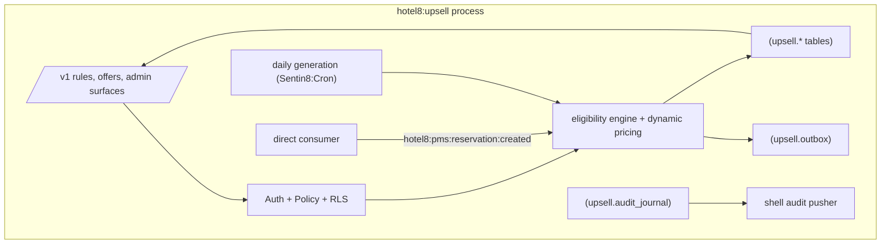

# Hotel8:Upsell - Offer Engine

## 1. Summary

Hotel8:Upsell is the offer-generation and guest-upsell engine of the hotel8
vertical. Its direct consumer reacts to PMS booking events, generates
context-appropriate offers (upgrades, early check-in, late check-out,
amenities) from tenant-authored eligibility rules, prices them dynamically,
and accepts/declines guest responses - recording the transaction and settling
payment through the platform's payments lane.

## 2. Motivation

Incremental revenue per stay is a primary hotel KPI, but upsell offers must
be relevant (room-type compatibility, stay dates, guest tier) and never
annoying (frequency caps, decline memory). A dedicated engine turns offer
strategy into data (eligibility rules) plus events (`reservation.created`)
instead of hard-coding marketing logic into the booking path.

## 3. Architecture & High-Level Design

Same shell-owned construction; the direct bus consumer does the offer
generation, with tenant-configured ABAC eligibility (guest-tier offer
eligibility) as a Shield concern.

## 4. Key Traits and Data Structures

- `EligibilityRule` - tenant-authored condition set (stay window, room-type
  compatibility, guest tier, frequency caps) evaluated against the booking
  snapshot carried in the event payload.
- A/B test allocation - variant assignment recorded per offer so conversion
  comparisons are honest.
- `Publisher` - caller identity for outbox rows.

## 5. Rationale, Trade-offs, and Alternatives

- **Rules as data** - marketing tunes offers without deploys; the alternative
  (code-embedded offers) couples revenue experimentation to release trains.
- **Pricing as a computed result with provenance** - dynamic prices record the
  inputs (rule id, demand signal) so guests and staff can audit "why this
  price".
- **Event-triggered generation** - booking moments are the natural trigger;
  batch generation rides Sentin8:Cron for daily re-eligibility sweeps. Both
  paths converge on the same engine.

## 6. Internal Implementation & Invariants (Private Design)

- An offer is idempotent per booking+rule pair - PMS event redelivery never
  duplicates an offer.
- Payment settlement is delegated: `hotel8:upsell:payment:processed`
  reflects the result; the engine never self-declares money movement.
- Guest declines suppress the same offer class for the stay (frequency cap).
- No `unsafe` code.

## 7. Unresolved Questions / Future Designs

- Multi-arm bandit allocation beyond fixed A/B variants.
- Length-of-stay upsell chains (multi-touch journeys).

---

**Architecture & Design:** hotel8:upsell and its underlying concepts were designed by [Hamid Jahanzad](https://www.linkedin.com/in/hamidjahanzad/).
